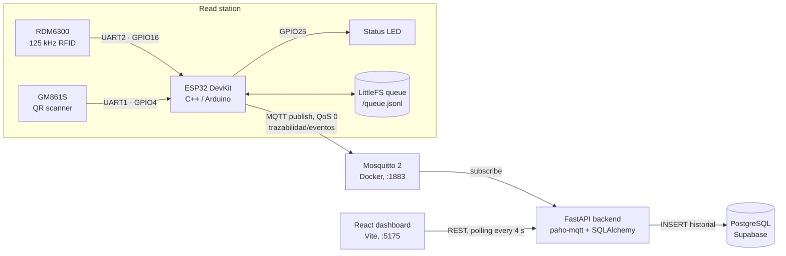
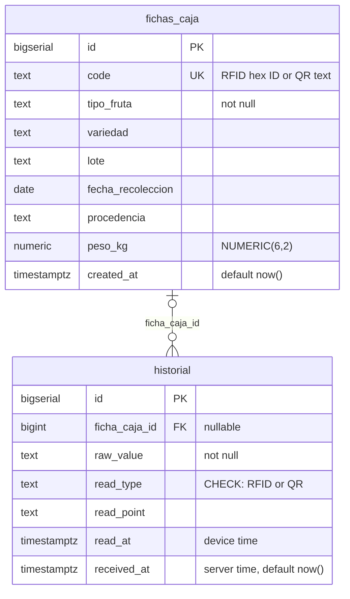

# Fruit Box Traceability System

> **ES:** Fruit Box Traceability System es un prototipo académico (TFG, Universidad de Córdoba) de trazabilidad de cajas de fruta: un ESP32 lee etiquetas RFID de 125 kHz y códigos QR y publica cada lectura por MQTT.
> Un backend FastAPI valida los eventos y los guarda en PostgreSQL (Supabase); el ESP32 conserva en flash las lecturas que no puede enviar y las reenvía al recuperar la red.

The Fruit Box Traceability System is an embedded RFID/QR prototype. An ESP32 read point identifies fruit boxes by 125 kHz RFID tag (RDM6300 module, EM4100-family cards) or by QR code (GM861S module) and publishes every read as a JSON event over MQTT. A FastAPI service subscribes to those events, validates them and stores them in PostgreSQL (hosted on Supabase); a small React dashboard shows the read history. The firmware keeps unsent events in a persistent queue in flash, so a network outage does not drop reads.


---

## Contents

- [Problem and scope](#problem-and-scope)
- [Architecture](#architecture)
- [Hardware](#hardware)
- [Firmware](#firmware)
- [MQTT interface](#mqtt-interface)
- [Backend](#backend)
- [Data model](#data-model)
- [Running it](#running-it)
- [Validation](#validation)
- [Repository layout](#repository-layout)
- [Status and known limitations](#status-and-known-limitations)
- [Credits](#credits)
- [License](#license)

## Problem and scope

Tracking fruit boxes as they move through a packing or storage facility requires recording which box passed through which point and when. The Fruit Box Traceability System builds one end-to-end slice of that: a read station that identifies a box, timestamps the read, and sends it to a central database where each read can be linked to a box record (fruit type, variety, batch, harvest date, origin, weight).

RFID is the primary identifier; QR is a second, independent read path for when a tag is missing or unreadable. Both readers are active at the same time and each read is stored as its own event.

**The Fruit Box Traceability System is an academic prototype**, built as a bachelor's thesis (Trabajo Fin de Grado). It has one read station, a local MQTT broker without authentication, and a backend intended for local use. It is not production software. See [Status and known limitations](#status-and-known-limitations).

## Architecture



| Component | Role | Code |
|---|---|---|
| Firmware | Polls both readers, builds a JSON event per read, publishes it over MQTT or queues it in flash if the broker is unreachable, drives the status LED. | [`firmware/`](firmware/) |
| Broker | Eclipse Mosquitto 2 in Docker. Anonymous access, persistence enabled. | [`docker-compose.yml`](docker-compose.yml), [`mosquitto/config/`](mosquitto/config/) |
| Backend | On startup, opens an MQTT subscription in a background thread. Each message is validated with Pydantic, matched to a box record by code, and inserted into `historial`. Also exposes a REST API for the dashboard. | [`backend/app/`](backend/app/) |
| Database | PostgreSQL hosted on Supabase, accessed directly through a connection string (no Supabase SDK). Schema managed with plain SQL migrations. | [`backend/migrations/`](backend/migrations/) |
| Dashboard | Read history with filters, charts of reads per hour/day/month and per fruit type, and a form to create and edit box records. Out of the thesis' core scope. | [`frontend/`](frontend/) |

## Hardware

| Part | Role |
|---|---|
| ESP32 DevKit (PlatformIO board `esp32dev`) | Microcontroller, WiFi |
| RDM6300 + coil antenna | 125 kHz RFID reader, UART output, 9600 baud |
| GROW GM861S | QR/barcode scanner, UART output, 9600 baud |
| LED | Read confirmation for demonstrations |

Assembled prototype: [`hardware/fotos/montaje_nodo_embebido.JPG`](hardware/fotos/montaje_nodo_embebido.JPG).

### Pinout

Taken from [`firmware/src/config/pins.h`](firmware/src/config/pins.h). Both readers only transmit; the ESP32 TX pins are not used.

| ESP32 pin | Peripheral | Connected to | UART settings |
|---|---|---|---|
| GPIO16 (RX, UART2) | RDM6300 | TX | 9600 8N1 (set by the `rdm6300` library) |
| GPIO4 (RX, UART1) | GM861S | TXD | 9600 8N1 (module factory default) |
| GPIO25 | LED | LED | Digital output, active high |

> **TODO:** LED series resistor value, power supply wiring and GND connections are not documented in the repository.

### Logic levels and power

- **GM861S:** the firmware comments state it works at 3.3 V natively and is wired to GPIO4 without a voltage divider.
- **RDM6300:** the firmware comments state its TX line goes directly to GPIO16 with no divider, following the wiring diagram of the `rdm6300` library.
- **Power:** the photo of the assembly shows an adjustable DC-DC converter module feeding the breadboard rails.

> **TODO:** document the supply voltage of each module and confirm the RDM6300 TX voltage level seen by GPIO16 (the ESP32 GPIOs are not 5 V tolerant).

### GM861S configuration

The scanner is configured by scanning setup codes from its manual. The ones used are saved in [`hardware/GM861S/`](hardware/GM861S/): serial (UART) output, continuous scan mode, CR line terminator and the 9600 baud default. The firmware reads one code per line, ending in `\r` or `\n`.

## Firmware

C++ on the Arduino framework, built with **PlatformIO** ([`firmware/platformio.ini`](firmware/platformio.ini)). There is no Arduino IDE sketch.

| Dependency | Version | Use |
|---|---|---|
| `arduino12/rdm6300` | `^2.0.0` | RDM6300 frame parsing and checksum |
| `knolleary/PubSubClient` | `^2.8` | MQTT client |
| `WiFi`, `LittleFS` | ESP32 Arduino core | Networking, flash filesystem |

Build flags: `MQTT_MAX_PACKET_SIZE=512`, `CORE_DEBUG_LEVEL=0`. Filesystem: LittleFS. Serial monitor: 115200 baud.

### Modules

| Path | Responsibility |
|---|---|
| `src/main.cpp` | `setup()` / `loop()`: polls RFID, then QR, every ~10 ms; publishes each event and signals the result on the LED. |
| `src/rfid/` | Thin wrapper over `Rdm6300`. Emits an event when a new tag is detected. |
| `src/qr/` | Reads lines from the GM861S UART. Ignores repeats of the same code within 7 s, because continuous mode re-reads a code several times per second. Codes are truncated to 63 characters. |
| `src/events/` | `Event` struct (RFID or QR) and serial debug output. |
| `src/network/` | WiFi, NTP time sync, MQTT connection, JSON payload, reconnection and queue flushing. |
| `src/storage/` | Persistent FIFO queue in LittleFS. |
| `src/led/` | Non-blocking LED patterns. |
| `src/config/` | Pins (`pins.h`) and network settings (`network_config.h`, git-ignored; template in `network_config.h.example`). |

### Disconnection handling

The goal is to not lose reads while the network or broker is down ([`network_manager.cpp`](firmware/src/network/network_manager.cpp), [`event_queue.cpp`](firmware/src/storage/event_queue.cpp)):

1. If the MQTT client is not connected when a read happens, the JSON payload is appended as one line to `/queue.jsonl` in LittleFS. The file survives reboots.
2. WiFi, NTP and MQTT reconnection are retried at most every 5 s, so reader polling keeps running. The MQTT socket timeout is 2 s, and WiFi power saving is disabled.
3. When WiFi drops, the MQTT client is explicitly disconnected so that a real reconnection happens when WiFi returns. WiFi is recovered with a full `WiFi.begin()` rather than `WiFi.reconnect()`.
4. After MQTT reconnects, the firmware waits 8 s before sending queued events. This gives the backend time to re-subscribe; it reconnects with a backoff of up to 5 s, and QoS 0 messages sent before it re-subscribes would be lost.
5. Queued events are then sent in FIFO order, at most one every 2 s. Each line is removed only after `publish()` succeeds.

LED feedback: three 0.5 s blinks when an event is published (immediately or from the queue); one 2 s blink when it is queued.

Timestamps come from NTP (`pool.ntp.org`, `time.nist.gov`) in UTC.

## MQTT interface

| Setting | Value |
|---|---|
| Broker | Mosquitto 2, port 1883, `allow_anonymous true` |
| Topic | `trazabilidad/eventos` (configurable on both sides) |
| QoS / retain | 0 / no |
| Client IDs | `esp32-trazabilidad-<MAC>` (firmware), `trazabilidad-backend` (backend) |

### Payload

One JSON object per read, built in `NetworkManager::publishEvent()`:

| Field | Type | Content |
|---|---|---|
| `raw_value` | string | RFID: 32-bit card number as uppercase hex without leading zeros (the `rdm6300` library drops the version byte). QR: decoded text. |
| `read_type` | string | `"RFID"` or `"QR"` |
| `read_at` | string | UTC timestamp from the ESP32 clock, `YYYY-MM-DDTHH:MM:SSZ` |
| `read_point` | string | Read station ID from `READ_POINT` (template value `estacion-1`) |

Example. The format is exactly what the firmware emits; the values are illustrative:

```json
{"raw_value":"1A2B3C4D","read_type":"RFID","read_at":"2026-09-08T10:15:42Z","read_point":"estacion-1"}
```

> **TODO:** replace with a captured message, e.g. from `docker exec trazabilidad-mosquitto mosquitto_sub -t trazabilidad/eventos -v`.

## Backend

FastAPI app in [`backend/app/`](backend/app/), configured through environment variables ([`core/config.py`](backend/app/core/config.py)).

### Event ingestion

[`app/mqtt/subscriber.py`](backend/app/mqtt/subscriber.py):

1. On startup (FastAPI lifespan), a paho-mqtt client connects to the broker and runs its network loop in a background thread. It subscribes in `on_connect`, so it re-subscribes after every reconnection. The reconnect backoff is 1–5 s.
2. Each message is parsed as `HistorialIn` ([`schemas/historial.py`](backend/app/schemas/historial.py)). `read_type` must be `RFID` or `QR`, `raw_value` must not be blank, and `read_at` must be a valid datetime. Invalid payloads are logged and dropped.
3. The backend looks up the box record whose `code` equals `raw_value`. It inserts a `historial` row with that `ficha_caja_id`, or `NULL` if no record matches. On a database error the transaction is rolled back and the error is logged.

### REST API

Interactive documentation at `http://localhost:8001/docs` (FastAPI's built-in OpenAPI UI).

| Method | Path | Description |
|---|---|---|
| `GET` | `/health` | Runs `SELECT 1` against the database. |
| `GET` | `/historial` | Reads, newest first. Query: `ficha_caja_id` (optional), `limit` (default 50, max 200). |
| `GET` | `/fichas-caja` | All box records, newest first. |
| `POST` | `/fichas-caja` | Create a box record. `409` if `code` already exists. |
| `PUT` | `/fichas-caja/{ficha_id}` | Replace a box record. `404` if missing, `409` on a duplicate `code`. |

CORS allows only `http://localhost:5175` (the dashboard dev server).

## Data model

Defined by the migrations in [`backend/migrations/`](backend/migrations/) (the tables started as `boxes` / `events` and were renamed in `0003`).



- **`fichas_caja`**: one row per physical box. `code` is the identifier the readers produce: the RFID hex ID or the QR text.
- **`historial`**: one row per read. A read of an unknown code is still stored, with `ficha_caja_id = NULL`. `read_at` is the device time and `received_at` the server insert time, so the gap between them shows reads that were delivered late from the queue.
- Indexes on `historial(ficha_caja_id)` and `historial(read_at)`.

## Running it

### Requirements

- ESP32 DevKit, RDM6300, GM861S (see [Hardware](#hardware))
- [PlatformIO](https://platformio.org/) (CLI, or the VS Code extension)
- Docker with Compose v2
- Python 3 (developed with 3.9; the version is not pinned)
- Node.js and npm (version not pinned in the repository)
- A PostgreSQL database. The thesis used a Supabase project.

The ESP32 and the machine running Mosquitto must be on the same network.

### Configuration

**Backend:** environment variables, read from `backend/.env`. A template is in [`backend/.env.example`](backend/.env.example).

| Variable | Required | Default | Description |
|---|---|---|---|
| `SUPABASE_DB_URL` | yes | none | PostgreSQL connection URI |
| `MQTT_BROKER_HOST` | no | `localhost` | Broker host |
| `MQTT_BROKER_PORT` | no | `1883` | Broker port |
| `MQTT_TOPIC_EVENTS` | no | `trazabilidad/eventos` | Topic to subscribe to |

**Firmware:** compile-time constants in `firmware/src/config/network_config.h`, created from [`network_config.h.example`](firmware/src/config/network_config.h.example). This file is git-ignored.

| Constant | Description |
|---|---|
| `WIFI_SSID`, `WIFI_PASSWORD` | WiFi credentials |
| `MQTT_BROKER_HOST` | LAN IP of the machine running Mosquitto |
| `MQTT_BROKER_PORT` | `1883` |
| `MQTT_TOPIC_EVENTS` | Must match the backend's `MQTT_TOPIC_EVENTS` |
| `READ_POINT` | Name of this read station |

### Steps

1. **Database:** apply the migrations in order. There is no migration runner; use `psql` or the Supabase SQL editor.

   ```bash
   for f in backend/migrations/0001_init.sql backend/migrations/0002_box_atributos.sql backend/migrations/0003_renombrar_tablas.sql; do psql "$SUPABASE_DB_URL" -f "$f"; done
   ```

2. **Broker:**

   ```bash
   docker compose up -d mosquitto
   ```

3. **Backend:**

   ```bash
   cd backend
   python3 -m venv .venv && source .venv/bin/activate
   pip install -r requirements.txt
   cp .env.example .env   # then edit SUPABASE_DB_URL
   uvicorn app.main:app --host 0.0.0.0 --port 8001 --reload
   ```

   Check it with `curl http://localhost:8001/health`.

4. **Dashboard:**

   ```bash
   cd frontend
   npm install
   npm run dev   # http://localhost:5175
   ```

   Steps 2–4 can also be run together with [`./start_local.sh`](start_local.sh) (macOS/Linux). It first kills any process listening on ports 8001 and 5175, then stops the backend and dashboard on Ctrl+C.

5. **Firmware:**

   ```bash
   cp firmware/src/config/network_config.h.example firmware/src/config/network_config.h
   # edit WIFI_SSID, WIFI_PASSWORD, MQTT_BROKER_HOST, READ_POINT
   cd firmware
   pio run -t upload
   pio device monitor
   ```

6. **Use:** create a box record whose `code` is the tag's hex ID (printed on the serial monitor when the tag is read) or the QR text. Then read the tag or code; the read appears in the dashboard within a few seconds.

### Testing without hardware

You can publish a test event from the broker container. It inserts a real row into `historial`:

```bash
docker exec trazabilidad-mosquitto mosquitto_pub -t trazabilidad/eventos -m '{"raw_value":"TEST-001","read_type":"QR","read_at":"2026-01-01T00:00:00Z","read_point":"manual"}'
```

## Validation

The thesis defined four validation criteria ([`docs/PLAN_DESARROLLO.md`](docs/PLAN_DESARROLLO.md), phase 6):

- read accuracy (RFID and QR);
- tolerance to WiFi/broker disconnections, i.e. no reads lost while offline;
- consistency between what the device reads and what is stored;
- the ability to query the history afterwards.

Test procedures, metrics and results are not included in this repository. **See the thesis report (memoria del TFG).**

The code comments do record some findings from hardware testing:

- a 4 s grace period after reconnecting lost events, so it was raised to 8 s;
- `WiFi.reconnect()` did not reliably recover a lost connection;
- PubSubClient could still report itself as connected after WiFi had dropped.

> **TODO:** add a summary table of results (or a link to the published report) once it can be made public.

## Repository layout

```
.
├── backend/
│   ├── app/
│   │   ├── api/           # REST routers: historial, fichas-caja
│   │   ├── core/          # settings (pydantic-settings)
│   │   ├── db/            # SQLAlchemy engine and session
│   │   ├── models/        # ORM models
│   │   ├── mqtt/          # MQTT subscriber and ingestion
│   │   ├── schemas/       # Pydantic schemas
│   │   └── main.py        # FastAPI app, lifespan, CORS, /health
│   ├── migrations/        # SQL migrations, applied manually
│   ├── requirements.txt
│   └── .env.example
├── firmware/
│   ├── src/               # see "Firmware > Modules"
│   └── platformio.ini
├── frontend/              # React + Vite dashboard
├── hardware/
│   ├── GM861S/            # scanner manual and setup codes
│   └── fotos/             # photo of the assembled prototype
├── mosquitto/config/      # broker configuration
├── docs/                  # development plan, Gantt chart, report outline (Typst)
├── docker-compose.yml     # Mosquitto
└── start_local.sh         # starts broker, backend and dashboard
```

## Status and known limitations

The Fruit Box Traceability System works end to end on one read station on a local network. Known limitations, from the current code:

**Security** (acceptable for a local demo, not for deployment):

- The MQTT broker allows anonymous connections and uses no TLS.
- The REST API has no authentication; anyone who can reach port 8001 can create or modify box records.
- The backend binds to `0.0.0.0`.

**Delivery guarantees:**

- MQTT runs at QoS 0 and the backend sends no acknowledgement. The LED "success" pattern means the event reached the broker, not the database. A message published while the backend is not subscribed is lost; the 8 s grace period reduces this window but does not close it.
- An event is removed from the queue only after it is published. If the device resets between those two steps, the event can be sent twice. The database has no deduplication key.
- If the ESP32 boots without network and records reads before its first NTP sync, those reads carry a timestamp near 1970-01-01.
- The queue has no size limit and is rewritten in full on each removal, so a long outage makes flushing slower.

**Identification:**

- A box record has a single `code`, so RFID and QR reads of the same box only resolve to the same record if the QR encodes the RFID hex ID. Reads from the two readers are not merged.
- The box record is matched only when the read is ingested. Creating the record later does not back-fill `ficha_caja_id` on earlier reads (the dashboard compensates by matching on `code`).
- QR codes longer than 63 characters are truncated. Repeated reads of the same QR code within 7 s are discarded.

**Operations:**

- WiFi credentials and the broker IP are compiled into the firmware; changing network requires reflashing.
- `GET /historial` returns at most 200 rows with no pagination, so the dashboard charts only cover the latest 200 reads.
- The dashboard's API URL (`http://localhost:8001`) and the backend's CORS origin are hard-coded.
- There are no automated tests, and migrations are applied by hand.

## Credits

Bachelor's thesis (Trabajo Fin de Grado), Degree in Computer Engineering (Grado en Ingeniería Informática), University of Córdoba, 2026.

Author: [@ismaeloficial](https://github.com/ismaeloficial)

Supervised by José Manuel Palomares Muñoz and Juan Carlos Gámez Granados.

> **TODO:** pending confirmation that the supervisors can be named here.

Third-party libraries: [rdm6300](https://github.com/arduino12/rdm6300), [PubSubClient](https://github.com/knolleary/pubsubclient), FastAPI, SQLAlchemy, paho-mqtt, React, Recharts. Each is under its own license.

## License

All rights reserved. The source code is published for viewing only, as part of an academic and professional portfolio. It may not be used, copied, modified or redistributed without written permission. See [LICENSE](LICENSE).
